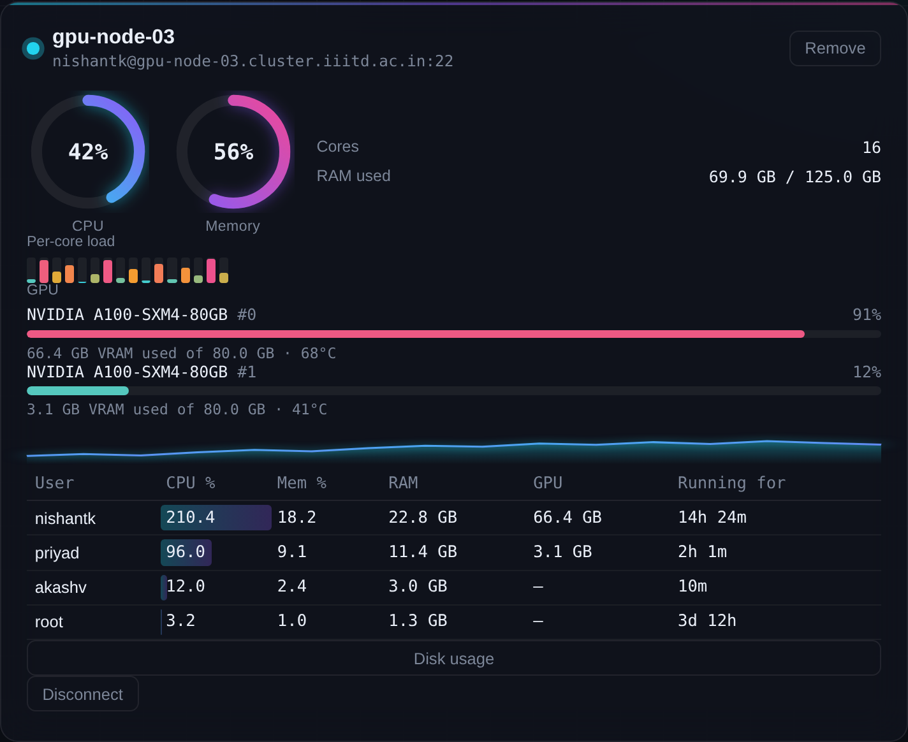

# Cluster Watch

A local dashboard for watching your own HPC servers over SSH — live CPU,
memory, per-core load, GPU usage, disk space, and a breakdown of which user
is using how much RAM/CPU/GPU and for how long. Nothing is installed on the
remote servers, and your password/OTP are typed once per session, not on
every refresh.



## Why

If you work across several shared HPC servers, checking on them usually
means opening a terminal, SSH-ing in, and running `top` / `free` / `ps` /
`nvidia-smi` by hand, once per server, every time. Cluster Watch keeps one
authenticated SSH session open per server and polls it for you, so all of
them show up side by side in a browser tab, updating in real time — and it
can keep running in the background so it's just there whenever you check.

## Features

- **Live CPU and memory** — glowing ring gauges per server, updated every
  few seconds
- **Per-core heat-map** — spot a single-threaded job pegging one core vs.
  real multi-core usage at a glance
- **GPU detection** — if `nvidia-smi` is available on a server, each GPU's
  utilization, VRAM used/total, and temperature show up automatically, with
  per-user GPU memory folded into the same user table as CPU/RAM. Servers
  without a GPU just don't show the section — nothing to configure
- **CPU trend sparkline** — the last couple of minutes of load, so you can
  tell a spike from a sustained run
- **Per-user breakdown** — who is using how much CPU/RAM/GPU right now, and
  how long their longest-running process has been up, sortable by any column
- **Disk usage on demand** — click **Disk usage** on any server to see
  every real filesystem's used/free/total space
- **Add as many servers as you want**, each with its own panel
- **Auth once per session** — works with plain passwords and with
  keyboard-interactive MFA (password + OTP), which is how most HPC clusters
  do it; after that one login, every poll reuses the same SSH session
- **Runs until you stop it, reachable from your LAN** — `./start.sh` runs it
  in the background and prints the URL for this device and for others on
  your network; `./stop.sh` shuts it down
- **Nothing installed remotely** — every metric comes from standard,
  read-only commands (`nproc`, `/proc/stat`, `free`, `ps`, `df`, and
  `nvidia-smi` if present) that are already on the box
- **Local-only by default** — your SSH password/OTP are held in memory for
  the life of the SSH session and never written to disk

## Quick start

```bash
git clone https://github.com/<your-username>/cluster-watch.git
cd cluster-watch
pip install -r requirements.txt
uvicorn main:app --host 127.0.0.1 --port 8000
```

Open **http://127.0.0.1:8000**, add a server (label, host, port, username),
click **Connect**, and type your password (and OTP, if your cluster asks
for one). The panel fills in within a few seconds.

## Running it long-term, and from other devices on your network

Instead of the command above, use the included scripts — they run the
dashboard in the background (so it keeps going after you close the
terminal) and bind to your LAN so you can check it from your phone or
another machine:

```bash
DASHBOARD_PASSWORD=some-secret ./start.sh
```

This prints two URLs — one for this device (`127.0.0.1`) and one for the
rest of your network (e.g. `http://192.168.1.42:8000`). Stop it any time
with:

```bash
./stop.sh
```

**Set `DASHBOARD_PASSWORD`** whenever you do this — it puts a login screen
in front of the whole dashboard so other people on your network can't just
open the tab. `start.sh` warns you if you skip it. This is a separate
password from any HPC server's own login; it's never sent anywhere but this
app, and sessions are cookie-based (works for the websocket too), not
stored on disk.

If you only ever want this device to access it, `HOST=127.0.0.1 ./start.sh`
skips the LAN binding entirely and no password is needed.

One honest caveat: traffic between your other devices and this dashboard is
plain HTTP, not HTTPS. On a trusted home or lab network that's normal for a
tool like this; on a network you don't fully trust, someone else on it
could in principle sniff what you type into the login screen. Stick to
networks you trust, and the `DASHBOARD_PASSWORD` gate at least keeps casual
snooping out.

## How it works

A small FastAPI backend opens one authenticated SSH transport per server
(via [paramiko](https://www.paramiko.org/)) and keeps it alive. Every few
seconds it runs a short, read-only shell probe over that same transport —
no re-authentication, no new SSH handshake — parses the output, and streams
it to the browser over a websocket. Disk usage is fetched the same way, but
only on demand, since `df` on a network home/scratch mount can be slower
than the CPU/memory checks.

```
Browser  ⇄  WebSocket  ⇄  FastAPI  ⇄  SSH (one session per server)  ⇄  HPC server
```

Only each server's label/host/port/username is persisted, in `servers.json`
next to `main.py`. Passwords and OTPs are never written to disk.

## Configuration

A couple of constants at the top of `main.py`:

| Setting             | Default | What it does                                          |
|----------------------|---------|--------------------------------------------------------|
| `POLL_INTERVAL`      | `4`     | Seconds between SSH probes, per server                 |
| `PUSH_INTERVAL`      | `1`     | Seconds between websocket pushes to the browser         |
| `DASHBOARD_PASSWORD` | unset   | Env var; if set, gates the whole dashboard behind a login screen |

`POLL_INTERVAL` is deliberately not fast — these are shared servers, so
turn it up if you're watching many at once.

## Notes

- If a server's `ps`/`free`/`df` output looks different (e.g. BusyBox
  instead of GNU coreutils), `PROBE_SCRIPT` and `DISK_SCRIPT` in
  `ssh_manager.py` are the two places to adjust.
- GPU stats need `nvidia-smi` reachable in your login shell on that server —
  true for most GPU nodes you SSH into directly. If a server is a login
  node that only submits jobs to GPU nodes via a scheduler (SLURM/PBS), the
  GPUs themselves aren't visible from there, so nothing will show.
- Some servers kill idle SSH sessions regardless of keepalives — if a
  panel shows disconnected, just click **Connect** again.
- "Running for" is the elapsed time of a user's longest-running current
  process — the closest thing standard `ps` can tell you about how long
  they've been using this much RAM.

## License

No license file is included yet — add one (MIT, Apache-2.0, etc.) before
making the repository public if you want the reuse terms to be explicit.
